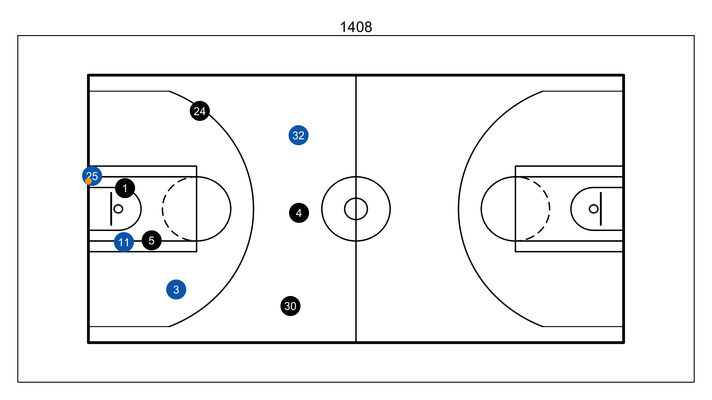

## Motivation: Play Animation

In Game 5 of the 2026 NBA Finals, the New York Knicks scored their first points on a [Jalen Brunson 3 point shot](https://uwmadison.box.com/s/2p4fohd0030yc7id7qvd8wurk0473up2).
@fig-brunson3pt shows an animation of the same play in which players are represented as dots (colored according to their team) move aross the plane (representing the court)

{width=60% fig-align="center" fig-alt="Animation in which dots (representing players and the ball) move about the plane (representing the basketball court)"  #fig-brunson3pt}

We will recreate this figure using recently-released tracking data from the NBA.


## Tracking Data in the NBA

NBA teams have used cameras to collect player tracking data during games since the 2009-10 regular season.
Initially, the league used [SportVU](https://en.wikipedia.org/wiki/SportVU), a system of six cameras and proprietary computer vision software initially developed for soccer.
In 2013, the league announced a [partnership with STATS, LLC](https://pr.nba.com/nba-stats-llc-partnership/) to deploy SportVU in all arenas and collect & distribute the data league-wide.
That partnership was renewed for the [2016-17 season](https://pr.nba.com/stats-llc-nba-sportvu-player-tracking-data/) before the league [switched to a different vendor (Second Spectrum)](https://pr.nba.com/nba-announces-multiyear-partnership-sportradar-second-spectrum/) for its optical tracking data.
Before the 2023-24 regular season, the NBA announced a [new partnership with Sony's Hawk-Eye Innovations](https://pr.nba.com/nba-sony-hawk-eye-innovations-partnership/) to deploy Hawk-Eye's 3D optical tracking system in all arenas.

Unlike the NFL, the NBA has been extremely reluctant to release any of its tracking data to the public.
Much of the public research[^franks] based on these data has been done by groups who received special access.
Despite the lack of formal data releases, some NBA tracking data has still made it to the public domain.

[^franks]: For instance, these papers about [about quantifying defensive skill](https://projecteuclid.org/journals/annals-of-applied-statistics/volume-9/issue-1/Characterizing-the-spatial-structure-of-defensive-skill-in-professional-basketball/10.1214/14-AOAS799.pdf) and [introducing expected possession value](https://arxiv.org/pdf/1408.0777). 

During the 2014-15 regular season, the NBA added a feature to its website in which fans could watch video clips of individual players' shots *and* visualize the player & ball movements as dots moving around the court.
[Neil Johnson](https://www.linkedin.com/in/neilmjohnson/) found the data underpinning this functionality, scraped it, and shared all that data publicly [on GitHub](https://github.com/neilmj/BasketballData) [^neil-github].
In total, he got 632 games worth of data before the data were taken offline (and the NBA removed the tracking data visualization functionality from its website)[^neilball-1].
Since the data were publicly posted, many people have developed code for processing, analyzing, and visualizing these data. 
I recommend [this repository from Rajiv Shah](https://github.com/rajshah4/NBA_SportVu/tree/master) if you want to play around with the older tracking data. 

[^neil-github]: Although the latest commit removed most games, you can access the full data from an [earlier commit](https://github.com/neilmj/BasketballData/tree/b46f92a9438df7661ddce203ed10625c1c4e586a/2016.NBA.Raw.SportVU.Game.Logs)

[^neilball-1]: You can read more about this project at [Neil's Substack](https://www.neilball.org/p/that-time-i-put-632-nba-games-of-player-tracking-data-on-github).

For the better part of a decade, these 632 games from the 2015-16 regular season were the only publicly available NBA tracking data until recently.
In October 2026, the NBA [announced several new features to its app](https://www.nba.com/news/nba-digital-experiences-2026-27) including Game Pulse which, to quote the NBA's press release "combines live court visualization... in a live-updating experience."
In other words, the dots on the court had returned and Neil Johnson once again found the underlying data, scraped it, and posted it publicly[^neilball-2].

[^neilball-2]: You can read more about how he did so on [his Substack](https://www.neilball.org/p/nba-released-player-tracking-data-for-2025-26-season). 

We will work with a portion of these data to create an animation of a single possession from Game 5 of the 2026 NBA Finals.

## Getting Started with Tracking Data

The full data archive (which is about 5GB in size) contains several files and a large directory containing the tracking data.
That directory contains sub-directories (one for each day) and each day's directory contains sub-directories (one for each game).
The games are uniquely indexed by a 10-digit numeric id.
For instance, the ID for Game 5 of the 2026 Finals is `0042500405`.

Each game's directory contains several JSON files[^JSON].
Player-tracking data is incredibly structured: player coordinates are nested within frames and frames are nested within games.
This makes JSON particularly well-suited for storing tracking data.

[^JSON]: [JavaScript Object Notation](https://en.wikipedia.org/wiki/JSON) is standard file format that stores data structured as name-value pairs. 

:::{.callout-note}

## Installing jsonlite

To work with data stored in JSON format, you will need to install the **jsonlite** package using the code `install.packages("jsonlite")`
:::

We will start by exploring the data contained in the file `metadata.json`.
Note that R will usually read JSON files in as large named list.
```{r}
#| label: load-metadata
#| eval: true
#| echo: true

metadata <- jsonlite::fromJSON("metadata.json")
class(metadata)
names(metadata)
```

Many of the attributes in the game's metadata are self-explanatory (e.g., `game_id` and `game_data`).
It turns out the `game` element is itself a list and contains loads of information including the identities of the teams and players involved in the game.
```{r}
#| label: metadata-game
#| eval: true
#| echo: true
names(metadata$game)
```

For our purposes, it will be useful to get the identities of the teams and players.
```{r}
#| label: metadata-teamID
#| eval: true
#| echo: true
homeID <- metadata$game$homeTeam$teamId
awayID <- metadata$game$awayTeam$teamId
```

We will also build a data frame containing player name, jersey number, team, and numeric id.

```{r}
#| label: metadata-players
#| eval: true
#| echo: true
n_players <- length(metadata$players)

player_df <- data.frame(name = rep(NA, times = n_players), 
                        personID = rep(NA, times = n_players),
                        teamID = rep(NA, times = n_players),
                        jersey = rep(NA, times = n_players))
for(i in 1:n_players){
  player_df$name[i] <- metadata$players[[i]]$name
  player_df$personID[i] <- metadata$players[[i]]$personId
  player_df$teamID[i] <- metadata$players[[i]]$team_id
  player_df$jersey[i] <- metadata$players[[i]]$jerseyNum
}

set.seed(441)
player_df |> dplyr::slice_sample(n=5)
```

The tracking data itself is stored in JSON Lines format[^jsonl-ncbi], which requires slightly different syntax to load into R.

[^jsonl-ncbi]: If you want to know more about why JSON and JSON Lines are useful, check out [this article from NCBI](https://www.ncbi.nlm.nih.gov/datasets/docs/v2/reference-docs/file-formats/metadata-files/why-jsonl/).

```{r}
#| label: load-tracking
#| eval: true
#| echo: true
connection <- gzfile("tracking.jsonl.gz") 
raw_data <- jsonlite::stream_in(connection)
```
In total, the tracking data file contains `nrow(raw_data)` lines, with each line representing a single frame, and several different "columns"[^list]
```{r}
names(raw_data)
```

[^list]: Rather than viewing the data as a traditional table, it's better to think of it as a list with each element having the same length (and arranged in the same order)

The variables `timestampe_ms` and `timestamp_utc` record the timestamp for each frame.
It turns out that during game play (i.e., when `period` is not `NA`), the frames are sampled approximately every 200 milliseconds.
The gaps are due to a combination of missing tracking data and stoppage periods. 
```{r}
#| label: get-frequency
#| eval: true
#| echo: true
qtr1 <- raw_data |> dplyr::filter(period == 1) #<1>
summary(diff(qtr1$timestamp_ms)) #<1>
```
1. Get all the frames from the 1st quarter
2. `diff` computes successive differences


The `quality` element returns a data frame with information about the players on the court.
Importantly, it tracks the 
```{r}
#| label: view-quality
#| eval: true
#| echo: true
set.seed(441)
raw_data$quality |> dplyr::slice_sample(n = 10)
```
We can tabulate the number of players whose locations are recorded in every frame
```{r}
#| label: tabulate-observed-players
#| eval: true
#| echo: true
table(raw_data$quality$observed_players)
```

We see that there are some frames with no player locations recorded and other frames with 10 players.
For simplicity, we will focus only on the frames with at least one and no more than 10 player locations recorded.

```{r}
#| label: filter-observed-players
#| eval: true
#| echo: true
tracking_data <-
  raw_data |>
  dplyr::filter(quality$observed_players %in% 1:10 & !is.na(period))
table(tracking_data$period)
```

In each frame (i.e., line/row in `tracking_data`), the player and ball locations are saved in `home_players`, `away_players`, and `ball`.
These are saved as individual data frames.
For instance, here are the home team locations at a single frame
```{r}
tracking_data$home_players[[1470]]
```

The "column" `xyz` contains the x, y, and z coordinate of the player.
```{r}
#| label: single-xyz
#| eval: true
#| echo: true
tracking_data$home_players[[1470]]$xyz[[1]]
```
The following codeblock builds a data table where each row is a frame-player combination.
It will contain all available tracking data in a *long* format

```{r}
#| label: build-positions
#| eval: true
#| echo: true
positions <- list() #<1>
for(i in 1:nrow(tracking_data)){
  tmp_players <- 
    tracking_data$home_players[[i]] |> #<2>
    dplyr::bind_rows(tracking_data$away_players[[i]]) |> #<2>
    dplyr::rowwise() |>
    dplyr::mutate(x = unlist(xyz)[1], y = unlist(xyz)[2], z = unlist(xyz)[3]) |> #<3>
    dplyr::ungroup() |>
    dplyr::select(-xyz) # <4>
  
  if(!is.null(tracking_data$ball$xyz[[i]])){ #<5>
    tmp_ball <-
      data.frame(
        player_id = 0L,#<6>
        team_id = 0L, 
        on_court = TRUE, 
        x = tracking_data$ball$xyz[[i]][1],
        y = tracking_data$ball$xyz[[i]][2],
        z = tracking_data$ball$xyz[[i]][3])
  } else{
    tmp_ball <-
      data.frame(
        player_id = 0L, 
        team_id = 0L, 
        on_court = TRUE, 
        x = NA,
        y = NA,
        z = NA)
  }
  
  
  
  positions[[i]] <-
    dplyr::bind_rows(tmp_players, tmp_ball) |> #<7>
    dplyr::mutate( #<7>
      frame = i,#<7>
      game_clock_ms = tracking_data$game_clock_ms[i], #<7>
      period = tracking_data$period[i],#<7>
      timestamp_ms = tracking_data$timestamp_ms[i],#<7>
      timestamp_utc = tracking_data$timestamp_utc[i])#<7>
  
  
}

positions_df <- #<8>
  dplyr::bind_rows(positions) |> #<8>
  dplyr::left_join( #<8>
    y = player_df |> dplyr::rename(player_id = personID) |> dplyr::select(player_id, name, jersey)) #<8>
```
1. We will loop over every frame in `tracking_data` and save the player & ball coordinates in a data table. We will temporarily save these frame-level tables in a list and then concatenate them all at the very end. 
2. Create a single table with all home and away players
3. Extracts the individual coordinates into three separate columns
4. Removes the `xyz` variable, which stored coordinates in a single vector
5. If we have available ball coordinates, we'll save those too
6. So that we can put ball and player coordinates in a single table, we'll give the ball a `player_id` and `team_id` of `0L`. The `L` records this as an integer and not a double
7. Combine the player & ball data and add columns recording the frame number, game clock and timestamps
8. Concatenate across frames and also join in player names and jersey numbers


## Animating a Single Play

We will focus on the first made shot by the Knicks in the game --- a successful 3 point shot by Jalen Brunson.
To do this end, we create a single data frame where the game clock is between 9:48 and 9:28 in the first quarter.
```{r}
#| label: get-brunson-possession
#| eval: true
#| echo: true
possession <-
  positions_df |>
  dplyr::filter(period == 1 & 
                  game_clock_ms < (9 * 60 + 48) * 1000 & 
                  game_clock_ms >= (9*60 + 28) * 1000) |>
  dplyr::arrange(frame)
```

We can visualize the entire trajectory of Brunson, one Spurs defender (Stephon Castle), and the ball over the span of these 20 seconds.
Importantly, the coordinate system places the origin at mid-court.
Regulation NBA courts measures 94 ft by 50 ft so the court coordinates are in the range $[-47,47] \times [-25, 25]$.

```{r}
#| label: fig-trajectory
#| eval: true
#| echo: true
#| fig-align: center

brunson_id <- player_df |> dplyr::filter(name == "Jalen Brunson") |> dplyr::pull(personID)
castle_id <- player_df |> dplyr::filter(name == "Stephon Castle") |> dplyr::pull(personID)
brunson <- possession |> dplyr::filter(player_id == brunson_id)
castle <- possession |> dplyr::filter(player_id == castle_id)
ball <- possession |> dplyr::filter(player_id == 0L)

knicks_blue <- "#006bb6" #<1>
knicks_orange <- "#f58426" #<1>
spurs_black <- "#000000" #<1>
spurs_silver <- "#c4ced4" #<1>

par(mar = c(3,3,2,1), mgp = c(1.8, 0.5,0))

plot(1, type = "n", xlim = c(-47, 47), ylim = c(-25, 25)) #<2>
rect(xleft = -47, ybottom = -25, xright = 47, ytop = 25) #<3>

points(ball$x, ball$y, col = 'orange', pch = 16, cex = 1)
lines(ball$x, ball$y, col = 'orange')

points(brunson$x, brunson$y, col = knicks_blue, pch = 16, cex = 1.5)
lines(brunson$x, brunson$y, col = knicks_blue)

points(castle$x, castle$y, col = spurs_black, pch = 16, cex = 1.5)
```
1. You can look up color codes corresponding to each NBA team at [nbacolors.com](https://nbacolors.com).
2. `plot` will include a bit of padding beyond the horizontal and vertical limits set by `xlim` and `ylim`
3. Draw a rectangle representing the absolute edges of the court.


### Adding Court Landmakrs

We can improve the plot above by adding in several court landmarks based on measurements provided in the [NBA Rulebook](https://ak-static.cms.nba.com/wp-content/uploads/sites/4/2019/02/NBA-Court-Dimensions-.png).

{width=60% fig-align="center" fig-alt="Diagram with several circles and lines corresponding to different landmarks of an NBA court along with measurements"}


```{r}

draw_circle <- function(center = c(0,0), theta_start = 0, theta_end = 2*pi, radius = 1, lwd = 1.5, lty = 1){
  theta_seq <- seq(theta_start, theta_end, length = 1000)
  x <- center[1] + radius*cos(theta_seq)
  y <- center[2] + radius*sin(theta_seq)
  lines(x,y, lwd = lwd, lty = lty)
}

plot_court <- function(){
  
  par(mar = c(1,1,2,1), mgp = c(1.8, 0.5, 0))
  plot(1, type= "n", xlim = c(-55, 55), ylim= c(-30,30), xaxt = "n", yaxt ="n") #<1>
  rect(-47, -25, 47, 25, lwd = 3) #<2>
  lines(x = c(0,0), y = c(-25,25), lwd = 1.5) # <3>
  
  draw_circle(center = c(0,0), radius = 6)
  draw_circle(center = c(0,0), radius = 2)
  
  
  draw_circle(center = c(-47+5.25, 0), radius = 0.75) #<4>
  draw_circle(center = c(47 - 5.25, 0), radius = 0.75) #<4>
  
  rect(xleft = -47, ybot = -6, xright = -47 + 19, ytop = 6, lwd = 1.5) #<5>
  rect(xleft = 47-19, ybot = -6, xright = 47, ytop = 6, lwd = 1.5)  #<5>
  rect(xleft = -47, ybot = -8, xright = -47+19, ytop = -6, lwd = 1.5) #<5>
  rect(xleft = -47, ybot = 6, xright = -47+19, ytop = 8, lwd = 1.5) #<5>
  rect(xleft = 47-19, ybot = -8, xright = 47, ytop = -6, lwd = 1.5) #<5>
  rect(xleft = 47-19, ybot = 6, xright = 47, ytop = 8, lwd = 1.5) #<5>
  
  draw_circle(center = c(47-5.25, 0), #<6>
              theta_start = pi/2 + acos(22/23.75), theta_end = 3*pi/2 - acos(22/23.75), #<6>
              radius = 23.75) #<6>
  draw_circle(center = c(-47+5.25, 0), #<6>
              theta_start = 3*pi/2 + acos(22/23.75), theta_end = 2*pi + pi/2 - acos(22/23.75), #<6>
              radius = 23.75) #<6>
  
  tp_line_length <- sqrt(23.75^2 - 22^2) #<7>
  lines(x = c(-47, -47+tp_line_length + 5.25), y = c(22,22)) #<7>
  lines(x = c(-47, -47+tp_line_length + 5.25), y = c(-22,-22)) #<7>
  lines(x = c(47-tp_line_length - 5.25, 47), y = c(22,22)) #<7>
  lines(x = c(47-tp_line_length - 5.25, 47), y = c(-22,-22)) #<7>
  
  draw_circle(center = c(47-5.25, 0), #<8>
              theta_start = pi/2, theta_end = 3*pi/2, #<8>
              radius = 4) #<8>
  lines(x = c(47-5.25, 47), y = c(-4,-4), lwd = 1.5) #<8>
  lines(x = c(47-5.25, 47), y = c(4,4), lwd = 1.5) #<8>
  
  draw_circle(center = c(-47+5.25, 0), #<8>
              theta_start = 3*pi/2, theta_end = 3*pi/2 + pi, #<8>
              radius = 4) #<8>
  lines(x = c(-47+5.25, -47), y = c(-4,-4), lwd = 1.5) #<8>
  lines(x = c(-47+5.25, -47), y = c(4,4), lwd = 1.5) #<8>
  
  lines(x = c(-47+4, -47+4), y = c(-3,3), lwd = 2) #<9>
  lines(x = c(47-4, 47-4), y = c(-3,3), lwd = 2) #<9>
  
  draw_circle(center = c(-47+19, 0), #<10>
              theta_start = 3*pi/2, theta_end = 5*pi/2, radius = 6, lty = 1) #<10>
  draw_circle(center = c(-47+19, 0), #<10>
              theta_start = pi/2, theta_end = 3*pi/2, radius = 6, lty = 2) #<10>
  
  draw_circle(center = c(47-19, 0), #<10>
              theta_start = 3*pi/2, theta_end = 5*pi/2, radius = 6, lty = 2) #<10>
  draw_circle(center = c(47-19, 0), #<10>
              theta_start = pi/2, theta_end = 3*pi/2, radius = 6, lty = 1) #<10>
 
}

```
1. The playable area is 94ft x 50ft but we will set a larger plot range to account for the apron (i.e., the out-of-bounds areas surrounding the court).
2. Boundary of the court
3. Halfline
4. Center of the rim is 5'3" away from the baseline and has a 9" internal radius
5. Box inside the key measures 19' x 12' and the whole key measures 19' x 16'
6. Circular part of the three point arc has a radius of 23'9" and 22" to the corner. With a bit of trigonometry, we can figure out how much of the circular arc to draw
7. Compute how far the three point line extends parallel to the sidelines and perpendicular to baseline. Then add horizontal lines connecting to the arc.
8. The restricted area is formed with a half-circle of radius 4' from the center of the basket and extends to the baseline.
9. The backboard measures 6' across and its front edge is positioned 4' from the baseline 
10. The circle at the top of the key measures 6".


### Frame-by-Frame Illustration

To create an animation, we will make a separate image showing *all* players and the ball in each frame.
Then, we can stitch those images together into a GIF.
To simplify this process, we define a function in the codeblock that plots the locations in each frame.


```{r}
#| label: plot-frame-fn
#| eval: true
#| echo: true
plot_frame <- function(frame_number, homeID, awayID, home_col, away_col){
  
  plot_court() #<1>
  players <-
    possession |> 
    dplyr::filter(frame == frame_number & player_id != 0L) |>
    dplyr::mutate(
      col = dplyr::case_when(
        team_id == homeID ~ home_col,
        team_id == awayID ~ away_col))
  ball <-
    possession |>
    dplyr::filter(frame == frame_number & player_id == 0L) |>
    dplyr::mutate(col = "orange")
  
  points(players$x, players$y,
         pch = 16, cex = 3,
         col = players$col)
  text(players$x, players$y, labels = players$jersey, cex = 0.75,
       col = "white")
  mtext(frame_number, side = 3)
  
  points(ball$x, ball$y, col = ball$col, pch = 16)
}
```
1. Call our function to draw the court with all the landmarks

To illustrate, here are the positions of the players in frame number 1450 (approximately halfway through the possession).
```{r}
#| label: fig-frame1450
#| eval: true
#| echo: true
plot_frame(frame_number = 1450, homeID = homeID, awayID = awayID, home_col = spurs_black, away_col = knicks_blue)
```


In order to create an animation, we can plot the player and ball location in each frame and stitch them together into a GIF using [ImageMagick](https://imagemagick.org/).
You will first need to download the binary associated with your system from the [ImageMagick website](https://imagemagick.org/download/#gsc.tab=0) and follow the appropriate installation instructions.
Then, once you have saved the frame-by-frame images sorted chronologically by frame number in a directory, you can use the command
`magick` to create a GIF.
Full documentation for creating such animation is available [here](https://usage.imagemagick.org/anim_basics/). 
The most salient option to run with `magick` is `delay`, which controls the length of the pause between images.
Since the NBA data is sampled every 200ms, we will specify the option `-delay 20` to match the 5 frames per second rate in the data. 


:::{.callout-important}

## Subdirectory for Images
In the codeblock below, I set the variable `target` and use it when calling `png`.
This is the name of a sub-directory that I created within my working directory to hold the frame-by-frame images.
If you want to run this code locally, you will need to create a similar sub-directory and update the assignment of `target` with that sub-directory's name.
:::

```{r}
#| label: make-all-frames
#| eval: false
#| echo: true

target <- "figures/lecture23/"
for(frame_number in unique(possession$frame)){
  png(paste0(target, "/brunson3pt_", frame_number, ".png"),
      width = 8, height = 4.5, units = "in", res = 400)
  plot_frame(frame_number = frame_number, homeID = homeID, awayID = awayID,
             home_col = spurs_black, away_col = knicks_blue)
  dev.off()
}
```
