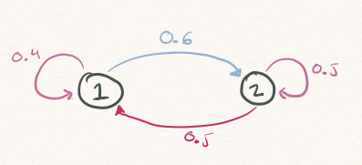
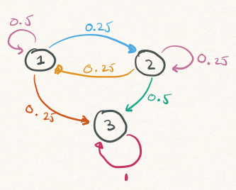
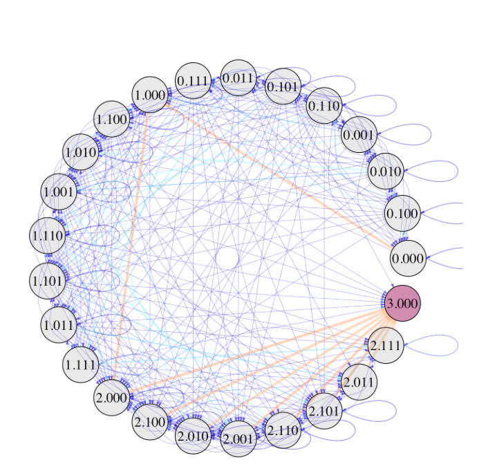

# Markov Chains Fundamentals

## Setting

- State space: $\mathcal{S} = \{1, 2, \ldots, S\}$
- $\{X_{t}\}$: infinite sequence of $\mathcal{S}$-valued random variables
- Interested in several probabilities & random quantities
  - $\mathbb{P}(X_{1} = s_{1}, X_{2} = s_{2}, X_{3} = s_{3}, X_{4} = s_{4}$): e.g., likelihood of seeing `0.000` to `1.000` to `2.000` to `3.000`
  - First $n$ such that $X_{n} \in A$: e.g., # at-bats needed to get at least one out
  - Amount of time to reach state $s$ starting from state $s'$

## Specifying Joint Distributions 

- To answer these questions, must define a **joint** probability distribution:
- For every infinite sequence of states $s_{1}, s_{2}, \ldots$ must specify
$$
\mathbb{P}(X_{1} = s_{1}, X_{2} = s_{2}, X_{3} = s_{3}, \ldots)
$$
- Can compute prob. of events of interest by 
  - Enumerating all infinite sequences for which event occurs
  - Sum the probabilities of those sequences
  
## Joints from Conditionals{.smaller}

- Specify joint dist. $\{X_{t}\}$ by specifying sequence of **conditional probabilities**
$$
\mathbb{P}(X_{t+1} = s \vert X_{t} = s_{t}, X_{t-1} = s_{t-1}, X_{t-2} = s_{t-2}, \ldots, X_{1} = s_{1})
$$

- Specifying how to generate next value based on all previous values

. . . 

- To characterize $X_{t+1}$, must specify a total of $S \times S^{t}$ different probabilities
  - $S$ possible states for $X_{t+1}$
  - $S^{t}$ possible sequences $s_{1}, \ldots, s_{t}$
  
## Markov Property

- $\{X_{t}\}$ satisfies the **Markov property** if:
  - For all $A \subset \mathcal{A}$
  - For all $t$ and sequences $s_{1}, \ldots s_{t}$
$$
\mathbb{P}(X_{t+1} \in A \vert X_{t} = s_{t}, \ldots, X_{1} = s_{1}) = \mathbb{P}(X_{t+1} \in A \vert X_{t} = s_{t})
$$

- What comes next depends only on current state & not past states

## Markov Chains

- If $\{X_{t}\}$ satisfies Markov property, we say it is a **Markov chain**

- Markov chains on state space $\mathcal{S} = \{1, 2, \ldots, S\}$ are determined by transition probability matrix
$$
\boldsymbol{\mathbf{P}} = \begin{pmatrix} p_{1,1} &  \cdots & p_{1,S} \\ \vdots &  ~ & \vdots \\ p_{S,1} & \cdots & p_{S,S} \end{pmatrix}
$$
- $p_{s, s'} = \mathbb{P}(X_{t+1} = s' \vert X_{t} = s)$: prob. of moving from $s$ to $s'$

## 2-State Example

- If chain is
  - At `1`: move to `2` w.p. 60% and remain at `1` w.p. 40%
  - At `2`: move to `1` w.p. 50% and remain at `2` w.p. 50%

{width=75% fig-align="center"}

## 3-State Example

- When the chain reaches `3`, it remains there.

{width=50% fig-align="center"}

## 3-State Example: Absorbtion Time{.smaller}

- Starting from `1`, how long until chain reaches state `3`?
- $T_{1}^{A} = \min\left\{t \geq 1: X_{t} = 3\right\}$
- See [notes](../../lectures/lecture14.qmd#sec-three-state) for code 
- Simulated 10,000 Markov chains

# A Markov Chain Model for Baseball

## Estimating Transition Probabilities

- Focus only on at-bats in the first 8 innings
- $n_{s,s'}$: number of at-bats starting in state $s$ and ending in $s'$
- $n_{s}$: number of at-bats starting in state $s$
- Estimate $p_{s,s'}$ with $n_{s,s'}/n_{s}$

## Baseball Transitions: Visualization

{width=50% fig-align="center"}

## Runs Scored{.smaller}

- $O_{t}$ and $B_{t}$: number of outs and runners at the **start** of at-bat $t$
- $O^{\star}_{t}$ and $B^{\star}_{t}$: numbers of outs and runners at the **end** of at-bat $t$
- Runs Scored during at-bat $t$:
$$
(O_{t} + B_{t} + 1) - (O_{t}^{\star} + B_{t}^{\star}).
$$

- Re-run simulation & keep running total of runs scored in each at-bat

# Further Markov Chain Theory

## $n$-step Transitions I {.smaller}

- Suppose $X_{t} = s$. What is $\mathbb{P}(X_{t+2} = s' \vert X_{t} = s)$? 
  - Starting from `1.000`, chances of being at `2.100` in exactly 2 at-bats?
- Must sum over all all *intermediate* states between $s$ and $s'$:
$$
\begin{align}
\mathbb{P}(X_{t+2} = s' \vert X_{t} = s) &= \sum_{k = 1}^{S}{\mathbb{P}(X_{t+2} = s', X_{t+1} = k \vert X_{t} = s)} \\
&= \sum_{k = 1}^{S}{\mathbb{P}(X_{t+2} = s' \vert X_{t+1} = k, X_{t} = s)\mathbb{P}(X_{t+1} = k \vert X_{t} = s)}
\end{align}
$$

## $n$-step Transitions II{.smaller}

- By Markov Property
$$
\mathbb{P}(X_{t+2} = s' \vert X_{t+1} = k, X_{t} = s) = \mathbb{P}(X_{t+2} = s' \vert X_{t+1} = k) = p_{k,s'}
$$

. . .

- Conclude that
$$
\mathbb{P}(X_{t+2} = s' \vert X_{t} = s) = \sum_{k = 1}^{S}{p_{s,k} p_{k,s'}}
$$

. . . 

- This is just matrix multiplication! $n$-step transition probability matrix

$$
\boldsymbol{\mathbf{P}}^{n} = \boldsymbol{\mathbf{P}} ~ \overbrace{\times \cdots \times}^{n \textrm{ times}} ~  \boldsymbol{\mathbf{P}}
$$

## Fundamental Matrix{.smaller}

- Suppose chain has $A$ absorbing states & $T$ non-absorbing states
- Partition transition matrix as
$$
\boldsymbol{\mathbf{P}} = \begin{pmatrix} Q & R \\ 0 & I_{A} \end{pmatrix},
$$
  - $Q$: transitions between non-absorbing states
  - $R$: transitions from non-absorbing to absorbing

- Fundamental Matrix: $N = (I_{T} - Q)^{-1}$

## Row Sums of $N$

- $n_{s,s'}$ number of expected visits to $s'$ by a chain started at $s$
- $\sum_{s'}{n_{s,s'}}$: expected number of states visited before absorption
- Starting from `1.000`, expect about 2.8 more at-bats before end of half-inning

## Reminders{.smaller}

- Project 2: simulation of a game, season, tournament, draft, etc.
  - Simulation powered by a probabilistic model
  - Could build a Bradley-Terry, Markov chain, or Plackett-Luce model
  - By October 28 (Wednesday): email me w/ your team's plans!
  - Due November 6

- Project 3: Big Data Bowl
  - Combine & game-tracking data
  - By November 6 (Friday): email me w/ group & choice of topic
  